<div align="center">
  

  <br />

  **A builder's notebook, not a collection of buzzwords.**

  [](https://shine0078.github.io/portfolio/)
  [](https://barcode-studio-25b.pages.dev/)
  [](https://github.com/Shine0078?tab=followers)

  [**Projects**](#-selected-builds) · [**My toolkit**](#-toolkit) · [**Engineering notes**](#-under-the-hood) · [**Activity**](#-the-build-log)
</div>

---

### `$ whoami`

I'm **Samuel**, a Computer Programming & Analysis graduate building toward software engineering, IT infrastructure and cloud security. I prefer practical, testable tools: the kind that help people solve problems, work faster or understand complicated systems.

```text
samuel@engineering:~$ cat focus.txt
→ Build useful software
→ Automate repetitive work
→ Understand systems end to end
→ Secure what matters
→ Keep learning in public
```

**Currently exploring:** browser tooling, AI agent orchestration, IT support automation, infrastructure, and dependable application delivery.  
**Working principle:** Build it → test it → explain it → improve it.

### ◈ Selected builds

<table>
<tr>
<td width="50%" valign="top">

#### [▣ Free Barcode Studio](https://github.com/Shine0078/barcode-studio)

A privacy-conscious, browser-based barcode tool for inventory and label workflows. Supports many symbologies, validation, exports and printable sheets.

**TypeScript · React · Barcode tooling**

[**Live app ↗**](https://barcode-studio-25b.pages.dev/) · [**Source ↗**](https://github.com/Shine0078/barcode-studio)

</td>
<td width="50%" valign="top">

#### [◈ Bot Buffet](https://github.com/Shine0078/bot-buffet)

A user-controlled, model-agnostic AI agent control plane. Exploring coordination, provider routing and stronger safety boundaries.

**TypeScript · Agent orchestration**

[**Explore source ↗**](https://github.com/Shine0078/bot-buffet)

</td>
</tr>
<tr>
<td valign="top">

#### [▤ IT Helpdesk Toolkit](https://github.com/Shine0078/IT-Helpdesk-Toolkit)

A PowerShell toolkit for repeatable support tasks, including system health checks, software inventory and administrative workflows.

**PowerShell · IT operations**

[**Explore source ↗**](https://github.com/Shine0078/IT-Helpdesk-Toolkit)

</td>
<td valign="top">

#### [◎ Finverse](https://github.com/Shine0078/finverse)

An evolving personal-finance application focused on a clearer experience for managing everyday money decisions.

**TypeScript · Application development**

[**Explore source ↗**](https://github.com/Shine0078/finverse)

</td>
</tr>
<tr>
<td valign="top">

#### [⌘ NetTrace Support Lab](https://github.com/Shine0078/nettrace-support-lab-site)

A public dashboard for a Windows and WSL2 network troubleshooting/support lab, with emphasis on observable, reproducible diagnostics.

**JavaScript · Networking · Troubleshooting**

[**Explore source ↗**](https://github.com/Shine0078/nettrace-support-lab-site)

</td>
<td valign="top">

#### [◇ Interactive Portfolio](https://github.com/Shine0078/portfolio)

A web portfolio exploring motion, visual storytelling and 3D interaction while presenting real engineering work.

**Next.js · TypeScript · Three.js**

[**Open portfolio ↗**](https://shine0078.github.io/portfolio/) · [**Source ↗**](https://github.com/Shine0078/portfolio)

</td>
</tr>
</table>

> **Status note:** Repositories are works in progress. Check each project's README, tests and issues for its current capabilities and release status.

### ◈ Toolkit

<div align="center">


</div>

<details>
<summary><b>🔍 What I'm learning next</b></summary>

- Network fundamentals, system administration and practical troubleshooting.
- Cloud architecture, secure access controls and infrastructure automation.
- Well-tested frontend/backend application development.
- Evaluation, reliability and security for AI-assisted systems.

These are **learning directions**, not claims of professional certification or expertise.
</details>

### ◈ Under the hood

<details>
<summary><b>🧪 My approach to testing</b></summary>

Start with user workflows and realistic failure cases. Add automated tests around parsing, validation and behavior. Verify production builds, and check important UI and print experiences in a browser.
</details>

<details>
<summary><b>🛡️ My approach to security</b></summary>

Prefer simple data flows, local processing when possible, reasonable permissions, input validation, dependency reviews, and clear limitations. Document known risks instead of promising perfect security.
</details>

<details>
<summary><b>🧰 What I like building</b></summary>

Tools with a practical use case: warehouse workflows, developer utilities, helpdesk automation, accessible interfaces, small labs, and reproducible engineering experiments.
</details>

<details>
<summary><b>📍 How to explore this profile</b></summary>

1. Open a **live demo** to see something working.
2. Open the linked **source repository** to inspect decisions and implementation.
3. Read the **tests, docs and issues** to see what's proven and what's next.

The animated header is an original SVG stored in this repository. All project descriptions point to real public repositories.
</details>

### ◈ The build log

<div align="center">

[](https://github.com/Shine0078?tab=overview)

<sub>Live GitHub activity, provided by a third-party visualization service; if the graph is unavailable, use <a href="https://github.com/Shine0078?tab=overview">GitHub's native activity view</a>.</sub>

</div>

---

<div align="center">

**Build with purpose. Stay curious. Make the work speak.**

[Source code](https://github.com/Shine0078?tab=repositories) · [Portfolio](https://shine0078.github.io/portfolio/) · [GitHub activity](https://github.com/Shine0078?tab=overview)

<sub>Profile visuals and copy are original. Project links are public; no private project details are exposed.</sub>

</div>
